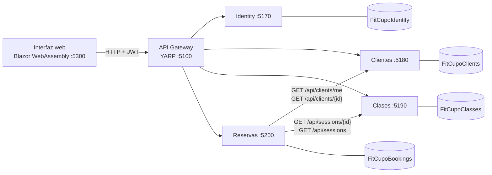
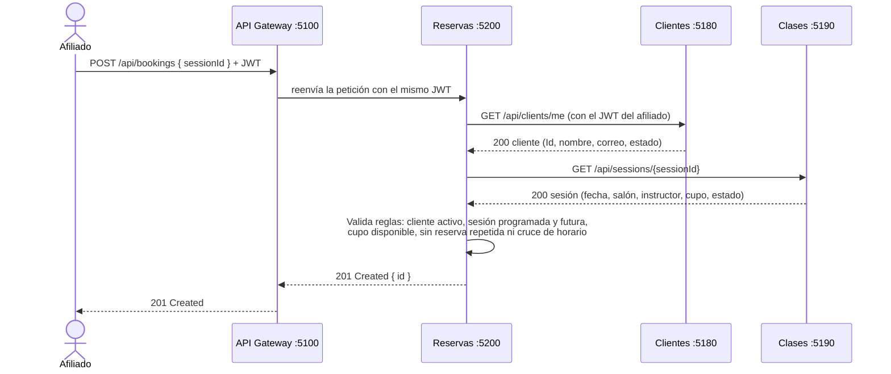
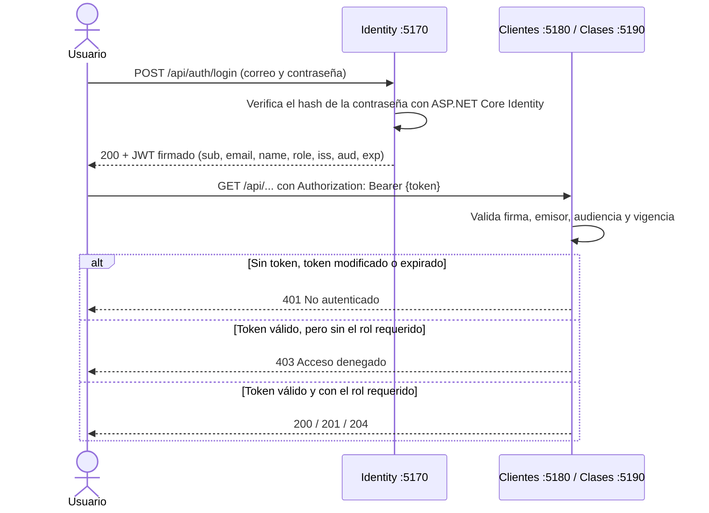
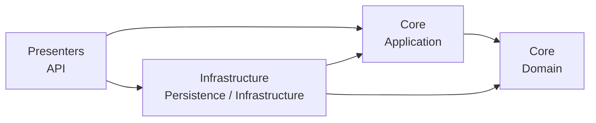

# FitCupo

Plataforma de reservas de clases grupales para un gimnasio, construida con microservicios.
Proyecto final de **Programación Distribuida**.

| Integrante | Entrega 1 | Entrega 2 | Entrega final (MVP) |
|---|---|---|---|
| Samuel Metaute Restrepo | Estructura de la solución y capa de Dominio | Identity: ASP.NET Core Identity, usuarios, roles y seeders | Reservas: dominio y casos de uso |
| Juana Ospina | Capa de Aplicación: mediador, paginación y contratos | Identity: inicio de sesión y emisión del JWT | Comunicación síncrona entre microservicios y API Gateway |
| David Viloria | Casos de uso (commands y queries) | Clases: dominio y casos de uso | Interfaz web: base, inicio de sesión y reservas del afiliado |
| Victor Manuel David | Capa de Persistencia (EF Core y SQL Server) | Clases: persistencia y API protegida con JWT | Reservas: persistencia y API |
| Carlos Arango | Capa de Presentación (API) y documentación | Clientes protegido por roles y documentación | Interfaz web: recepción e instructor, y documentación |

## MVP: qué hace FitCupo

| Rol | Qué puede hacer en la interfaz web |
|---|---|
| **Afiliado** (`afiliado@fitcupo.com`) | Ver el catálogo y el horario con los cupos disponibles, reservar una clase, ver sus reservas y cancelarlas |
| **Recepción** (`recepcion@fitcupo.com`) | Registrar clientes, buscarlos, reservar un cupo para un cliente y cancelar reservas |
| **Instructor** (`instructor@fitcupo.com`) | Programar sesiones de sus clases, cancelarlas y ver quién se inscribió |
| **Administrador** (`admin@fitcupo.com`) | Todo lo de recepción, además de activar y desactivar clientes |

Todos los usuarios tienen la contraseña **`FitCupo2026*`**. La pantalla de inicio de sesión tiene botones para llenar cada usuario.

### Flujo principal

1. **Recepción** registra a Laura Gómez como cliente con el correo `afiliado@fitcupo.com` (botón *Llenar con datos del afiliado de prueba*).
2. **El instructor** programa una sesión de Spinning para mañana en *Mis sesiones*.
3. **La afiliada** abre *Horario*, ve la sesión con sus cupos y la reserva. El cupo baja en uno.
4. **El instructor** abre *Inscritos* y ve a Laura en la lista.
5. **La afiliada** cancela su reserva en *Mis reservas* y el cupo se libera.

## Arquitectura general

Cada microservicio tiene su propia base de datos y valida el JWT por su cuenta.
La interfaz web solo conoce al **API Gateway**, que reenvía cada petición al microservicio que la atiende.
**Reservas** se comunica de forma **síncrona (HTTP)** con **Clientes** y **Clases** para validar cada reserva.



| Componente | Estado | Responsabilidad | Puerto | Base de datos |
|---|---|---|---|---|
| **Clientes** | ✅ Entrega 1 | Perfil de los afiliados del gimnasio | 5180 | `FitCupoClients` |
| **Identity** | ✅ Entrega 2 | Usuarios, roles y tokens JWT | 5170 | `FitCupoIdentity` |
| **Clases** | ✅ Entrega 2 | Catálogo de clases y horario de sesiones con instructor y aforo | 5190 | `FitCupoClasses` |
| **Reservas** | ✅ Entrega final | Reserva de cupos; consulta a Clientes y Clases | 5200 | `FitCupoBookings` |
| **API Gateway** | ✅ Entrega final | Punto de entrada único con YARP y estado de los microservicios | 5100 | — |
| **Interfaz web** | ✅ Entrega final | Aplicación Blazor WebAssembly para los cuatro roles | 5300 | — |
| Membresías | Fuera del MVP | Planes y vigencia de las membresías | — | — |
| Notificaciones | Fuera del MVP | Correos a los afiliados con eventos de RabbitMQ | — | — |

Clientes e Identity están separados: Identity guarda las credenciales y los roles para iniciar sesión;
Clientes guarda el perfil del afiliado (documento, contacto, contacto de emergencia y estado).
Los dos se relacionan por el correo: el afiliado ve su perfil en `GET /api/clients/me` con el correo de su token.

## Comunicación síncrona entre microservicios

Para crear una reserva, Reservas **no confía en lo que envía el navegador**: pregunta a los dueños de cada dato.



| Situación | Lo que responde Reservas |
|---|---|
| El afiliado no está registrado en Clientes | 404: *Todavía no estás registrado como cliente del gimnasio…* |
| El cliente está inactivo en Clientes | 400: *El cliente … está inactivo y no puede reservar clases.* |
| La sesión no existe en Clases | 404 |
| La sesión fue cancelada en Clases o ya empezó | 400 |
| La sesión no tiene cupos | 400: *La sesión de Yoga no tiene cupos disponibles (2 de 2 ocupados).* |
| El cliente ya reservó esa sesión u otra a la misma hora | 409 |
| **Clases o Clientes no responden** (detenidos o tardan más de 5 s) | **503**: *El microservicio de Clases no está disponible…* |

Cómo está hecho (`services/bookings/src/Infrastructure/FitCupo.Bookings.Infrastructure`):

- **`IHttpClientFactory` con clientes tipados**: `ClassesService` y `ClientsService` implementan los contratos `IClassesService` e `IClientsService` de la capa de aplicación. Los casos de uso no saben que la información viene de otra API.
- **`ForwardAuthorizationHandler`** copia el JWT de la petición original en la llamada a Clases y Clientes; cada microservicio lo valida y aplica sus permisos. Por eso `GET /api/clients/me` devuelve el perfil del afiliado dueño del token.
- **`OutgoingRequestLoggingHandler`** escribe en la consola de Reservas cada llamada con su resultado y duración, por ejemplo:
  `Reservas → GET http://localhost:5180/api/clients/me respondió 200 en 13 ms`.
- **`RemoteServiceClient`** traduce las respuestas: 404 → no existe, 401/403 → acceso denegado, caída o tiempo de espera → 503.
- Las direcciones se configuran en la sección `Services` de `appsettings.json` de Reservas.

El horario con cupos (`GET /api/bookings/schedule`) también es una llamada síncrona: Reservas pide las sesiones a Clases y les suma los cupos ocupados.
Y el Gateway consulta a los cuatro microservicios en `GET /api/status` para mostrar su estado en la página de inicio.

## Seguridad con JWT



- **Identity** está hecho con **ASP.NET Core Identity** y **Entity Framework Core**. Las contraseñas se guardan como hash (PBKDF2 con sal), nunca en texto plano. Después de 5 intentos fallidos la cuenta se bloquea 5 minutos.
- **Seeders:** al iniciar, `RoleSeeder` crea los roles y `UserSeeder` crea los usuarios con su rol. Si ya existen, no los duplica. No hay CRUD de usuarios ni de roles.
- **JWT firmado con HMAC-SHA256.** Dura 60 minutos (`Jwt:ExpirationMinutes`) y lleva los claims para identificar al usuario y sus roles.
- **Validación en cada microservicio** (`Security/JwtAuthenticationExtensions.cs`): firma, emisor (`FitCupo.Identity`), audiencia (`FitCupo`), algoritmo y vigencia, sin tolerancia de reloj. No basta con decodificar el token.
- **Autorización con los mecanismos de ASP.NET Core:** `[Authorize]` y `[Authorize(Roles = ...)]`. En Clases, además, un instructor solo puede cancelar **sus** sesiones: se compara el usuario del token con el instructor de la sesión.

### Usuarios y roles iniciales

Todos tienen la contraseña **`FitCupo2026*`** (se lee de `Seed:DefaultPassword` en `appsettings.Development.json`).

| Usuario | Nombre | Rol | Qué puede hacer |
|---|---|---|---|
| `admin@fitcupo.com` | Andrea Ruiz | `Admin` | Todo: clientes, catálogo de clases, cancelar cualquier sesión y ver los usuarios |
| `recepcion@fitcupo.com` | Mateo Torres | `Receptionist` | Registrar, consultar y actualizar clientes |
| `instructor@fitcupo.com` | Carolina Ríos | `Instructor` | Programar sesiones y cancelar las suyas |
| `instructor2@fitcupo.com` | Julián Pérez | `Instructor` | Igual que el anterior; sirve para probar que no puede cancelar sesiones ajenas |
| `afiliado@fitcupo.com` | Laura Gómez | `Member` | Consultar el catálogo, el horario y su propio perfil |

### Contenido del JWT

| Claim | Ejemplo | Uso |
|---|---|---|
| `sub` | `01a1da45-2df8-...` | Id del usuario en Identity |
| `email` | `admin@fitcupo.com` | Perfil del afiliado en Clientes |
| `name` | `Andrea Ruiz` | Nombre del instructor en las sesiones |
| `role` | `Admin` | Autorización por roles |
| `iss` / `aud` | `FitCupo.Identity` / `FitCupo` | Se validan en cada microservicio |
| `iat` / `nbf` / `exp` | fechas Unix | Vigencia de 60 minutos |
| `jti` | GUID | Identificador único del token |

### Permisos por endpoint

| Microservicio | Endpoint | Admin | Receptionist | Instructor | Member |
|---|---|:-:|:-:|:-:|:-:|
| Identity | `POST /api/auth/login` | público | público | público | público |
| Identity | `GET /api/auth/me` | ✅ | ✅ | ✅ | ✅ |
| Identity | `GET /api/users` | ✅ | ❌ | ❌ | ❌ |
| Clientes | `GET`, `POST /api/clients` · `GET`, `PUT /api/clients/{id}` | ✅ | ✅ | ❌ | ❌ |
| Clientes | `PATCH /api/clients/{id}/deactivate` · `/activate` | ✅ | ❌ | ❌ | ❌ |
| Clientes | `GET /api/clients/me` | ❌ | ❌ | ❌ | ✅ |
| Clases | `GET /api/classes` · `GET /api/classes/{id}` | ✅ | ✅ | ✅ | ✅ |
| Clases | `POST`, `PUT /api/classes` · `PATCH .../deactivate` · `.../activate` | ✅ | ❌ | ❌ | ❌ |
| Clases | `GET /api/sessions` · `GET /api/sessions/{id}` | ✅ | ✅ | ✅ | ✅ |
| Clases | `POST /api/sessions` | ❌ | ❌ | ✅ | ❌ |
| Clases | `PATCH /api/sessions/{id}/cancel` | ✅ cualquiera | ❌ | ✅ solo las suyas | ❌ |

Los permisos de Reservas están en la sección [Reservas](#reservas).

### 401 frente a 403

Los dos errores responden con **ProblemDetails** y un mensaje que explica el motivo:

| Caso | Código | `detail` |
|---|---|---|
| Petición sin token | 401 | Debes enviar un token JWT en el encabezado Authorization: Bearer {token}. |
| Token expirado | 401 | El token expiró el 2025-12-31 23:00:00 UTC. Inicia sesión de nuevo. |
| Token modificado o firmado con otra clave | 401 | La firma del token no es válida: el token fue modificado o no lo emitió Identity. |
| Token de otro emisor | 401 | El token no fue emitido por FitCupo Identity. |
| Usuario autenticado sin el rol | 403 | Laura Gómez inició sesión, pero su rol (Member) no tiene permiso para este recurso. |
| Instructor que cancela una sesión ajena | 403 | Solo puedes cancelar las sesiones que tú dictas. |

## Microservicios

Los cuatro siguen **Clean Architecture**: las dependencias apuntan hacia el centro, el controller solo usa `IMediator`
y los casos de uso están separados en *commands* y *queries* (CQRS).



### Identity

| Capa | Proyecto | Contenido |
|---|---|---|
| Aplicación | `FitCupo.Identity.Application` | Casos de uso `Login`, `GetUserById` y `GetUserList`; contratos `IIdentityService` e `ITokenGenerator`; roles |
| Infraestructura | `FitCupo.Identity.Infrastructure` | `ApplicationUser`, `ApplicationRole` y `ApplicationUserRole`; `FitCupoIdentityDbContext`; seeders; `IdentityService` con `UserManager` y `SignInManager`; `JwtTokenGenerator` |
| Presentación | `FitCupo.Identity.API` | `AuthController`, `UsersController`, validación de JWT y manejo de errores |

Identity no tiene capa de Dominio: las reglas de usuarios y contraseñas las aplica ASP.NET Core Identity.
Las tablas son `Users`, `Roles` y `UserRoles` (relación muchos a muchos, llave `(UserId, RoleId)`), más las auxiliares de Identity.

### Clases

| Capa | Proyecto | Contenido |
|---|---|---|
| Dominio | `FitCupo.Classes.Domain` | Agregados `GymClass` y `ClassSession`, value object `TimeSlot` y reglas de negocio |
| Aplicación | `FitCupo.Classes.Application` | Commands y queries del catálogo y del horario, mediador, paginación y contratos |
| Persistencia | `FitCupo.Classes.Persistence` | `ClassesDbContext`, configuraciones, repositorios, Unit of Work, migración y 3 clases iniciales |
| Presentación | `FitCupo.Classes.API` | `GymClassesController`, `ClassSessionsController`, validación de JWT y manejo de errores |

Reglas de negocio:

- El nombre de la clase es único. La duración va de 15 a 180 minutos y el aforo, de 1 a 60 personas.
- Solo se programan sesiones de clases activas, en una fecha futura y con máximo 60 días de anticipación.
- La hora de fin se calcula con la duración de la clase. El cupo de la sesión no puede superar el aforo de la clase.
- Un salón no puede tener dos sesiones que se crucen, y un instructor tampoco (409).
- El instructor de la sesión es el usuario del token: su Id (`sub`) y su nombre (`name`).
- Solo se cancela una sesión que no ha empezado, con un motivo de 5 a 200 caracteres.

### Clientes

| Capa | Proyecto | Contenido |
|---|---|---|
| Dominio | `FitCupo.Clients.Domain` | Agregado `Client`, value objects (`Document`, `Email`, `PhoneNumber`, `EmergencyContact`) y reglas de negocio |
| Aplicación | `FitCupo.Clients.Application` | Casos de uso con CQRS, mediador propio, DTOs, paginación y contratos de repositorio y Unit of Work |
| Persistencia | `FitCupo.Clients.Persistence` | `ClientsDbContext`, configuración de EF Core, repositorios, Unit of Work y migraciones |
| Presentación | `FitCupo.Clients.API` | Controller REST, validación de JWT, manejo global de errores y documentación OpenAPI |

Reglas de negocio:

- El documento es único y no se puede cambiar. La cédula solo admite números; el pasaporte, letras y números.
- El correo es único y se guarda en minúsculas.
- El cliente debe tener entre 14 y 100 años.
- El teléfono del contacto de emergencia debe ser distinto al del cliente.
- Un cliente inactivo no puede modificar sus datos. No se puede desactivar un cliente inactivo ni activar uno activo.
- Los clientes no se eliminan: se desactivan para conservar su historial.

### Reservas

| Capa | Proyecto | Contenido |
|---|---|---|
| Dominio | `FitCupo.Bookings.Domain` | Agregado `Booking` y value objects `BookableSession` y `BookingClient`, con las reglas de la reserva |
| Aplicación | `FitCupo.Bookings.Application` | Commands y queries de reservas, contratos `IClassesService` e `IClientsService`, mediador y paginación |
| Infraestructura | `FitCupo.Bookings.Infrastructure` | Clientes HTTP hacia Clases y Clientes, reenvío del JWT y registro de las llamadas |
| Persistencia | `FitCupo.Bookings.Persistence` | `BookingsDbContext`, repositorio, Unit of Work y migración |
| Presentación | `FitCupo.Bookings.API` | `BookingsController`, validación de JWT y manejo de errores (incluye 503) |

Reglas de negocio:

- Solo reserva un cliente **activo** en Clientes, en una sesión **programada y futura** de Clases.
- No se supera el cupo de la sesión. Un cliente no reserva dos veces la misma sesión ni dos clases a la misma hora.
- El afiliado reserva para sí mismo; recepción y el administrador reservan indicando el cliente.
- La reserva se cancela solo antes de que empiece la sesión. El afiliado solo cancela las suyas.
- La reserva guarda una copia de los datos de la sesión y del cliente para mostrar el historial sin volver a consultarlos.
- Un índice único filtrado (`SessionId`, `ClientId` con estado `Confirmed`) evita reservas repetidas aunque lleguen dos peticiones al mismo tiempo.

| Endpoint | Admin | Receptionist | Instructor | Member |
|---|:-:|:-:|:-:|:-:|
| `GET /api/bookings/schedule` (horario con cupos) | ✅ | ✅ | ✅ | ✅ |
| `POST /api/bookings` | ✅ para un cliente | ✅ para un cliente | ❌ | ✅ para sí mismo |
| `GET /api/bookings/me` | ❌ | ❌ | ❌ | ✅ |
| `GET /api/bookings` | ✅ | ✅ | ❌ | ❌ |
| `GET /api/bookings/{id}` | ✅ | ✅ | ❌ | ✅ solo las suyas |
| `PATCH /api/bookings/{id}/cancel` | ✅ | ✅ | ❌ | ✅ solo las suyas |
| `GET /api/bookings/sessions/{sessionId}` (inscritos) | ✅ | ✅ | ✅ solo sus sesiones | ❌ |

### API Gateway

`gateway/FitCupo.Gateway` usa **YARP** (Yet Another Reverse Proxy). Las rutas están en `appsettings.json`:

| Ruta | Microservicio |
|---|---|
| `/api/auth/**`, `/api/users/**` | Identity (5170) |
| `/api/clients/**` | Clientes (5180) |
| `/api/classes/**`, `/api/sessions/**` | Clases (5190) |
| `/api/bookings/**` | Reservas (5200) |
| `/api/status` | El Gateway responde el estado de los cuatro microservicios |

El Gateway no valida el JWT: lo deja pasar y cada microservicio lo valida, igual que en la Entrega 2.
También habilita **CORS** para la interfaz web (`http://localhost:5300`).

### Interfaz web

`web/FitCupo.Web` es una aplicación **Blazor WebAssembly** que corre en el navegador y llama al Gateway.

| Página | Ruta | Roles | Microservicios que usa |
|---|---|---|---|
| Inicio de sesión | `/login` | Todos | Identity |
| Inicio y estado de los microservicios | `/` | Todos | Gateway |
| Clases | `/clases` | Todos | Clases |
| Horario con cupos | `/horario` | Todos; el afiliado reserva y cancela | Reservas → Clases |
| Mis reservas | `/mis-reservas` | Afiliado | Clientes y Reservas |
| Clientes | `/clientes` | Recepción y administrador | Clientes |
| Reservas | `/reservas` | Recepción y administrador | Clientes y Reservas → Clientes y Clases |
| Mis sesiones | `/mis-sesiones` | Instructor | Clases y Reservas → Clases |

- El JWT se guarda en el `localStorage` del navegador y se envía en cada petición (`Services/ApiClient.cs`).
- `Auth/JwtAuthenticationStateProvider.cs` lee los claims del token para mostrar solo las opciones de cada rol.
- Los errores de los microservicios se muestran con el título y el detalle de su ProblemDetails.
- Si el token expira, la interfaz vuelve a la pantalla de inicio de sesión.

## Cómo ejecutarlo

### Requisitos

- [.NET SDK 10](https://dotnet.microsoft.com/download/dotnet/10.0)
- SQL Server. Sirve **LocalDB**, que se instala con Visual Studio, o SQL Server en Docker.

### Iniciar FitCupo completo

```bash
git clone https://github.com/samrx21/fitcupo.git
cd fitcupo
scripts\run-all.cmd
```

El script abre seis ventanas: los cuatro microservicios, el Gateway y la interfaz web.
Cuando todas digan `Now listening on`, abre **http://localhost:5300**.

También se pueden iniciar a mano, cada uno en su terminal:

```bash
dotnet run --project services/identity/src/Presenters/FitCupo.Identity.API
dotnet run --project services/clients/src/Presenters/FitCupo.Clients.API
dotnet run --project services/classes/src/Presenters/FitCupo.Classes.API
dotnet run --project services/bookings/src/Presenters/FitCupo.Bookings.API
dotnet run --project gateway/FitCupo.Gateway
dotnet run --project web/FitCupo.Web
```

En Visual Studio, abre `FitCupo.sln`, clic derecho en la solución → **Configurar proyectos de inicio** → **Varios proyectos de inicio**
y marca las cuatro API, `FitCupo.Gateway` y `FitCupo.Web`.

Al iniciar en modo Development, cada API **crea su base de datos y aplica las migraciones**.
Identity, además, **ejecuta los seeders** y muestra en la consola los roles y usuarios que crea.

| Componente | Dirección | Base de datos |
|---|---|---|
| Interfaz web | http://localhost:5300 | — |
| API Gateway | http://localhost:5100/api/status | — |
| Identity | http://localhost:5170/scalar | `FitCupoIdentity` |
| Clientes | http://localhost:5180/scalar | `FitCupoClients` |
| Clases | http://localhost:5190/scalar | `FitCupoClasses` |
| Reservas | http://localhost:5200/scalar | `FitCupoBookings` |

En Scalar, inicia sesión en Identity, copia el `accessToken` y pégalo en **Authentication → Bearer** del microservicio que quieras probar.

> **Importante:** abre la terminal **sin** permisos de administrador. Si una ventana de administrador inicia LocalDB,
> las ventanas normales no pueden conectarse. Si pasa, ejecuta `sqllocaldb stop MSSQLLocalDB -k` en esa ventana de administrador y ciérrala.

### Probar la comunicación síncrona

1. Con todo en ejecución, la afiliada reserva una sesión desde **Horario**. En la ventana de **Reservas** aparecen las llamadas a Clientes y a Clases.
2. Cierra la ventana de **Clases** (5190).
3. En la interfaz, el inicio muestra *Clases · no disponible* y el **Horario** responde *Servicio no disponible (503)*.
4. Vuelve a iniciar Clases y todo funciona de nuevo.

### Configuración del JWT

Los `appsettings.json` de los microservicios comparten la sección `Jwt` (emisor, audiencia y clave de firma). Identity agrega `ExpirationMinutes`.
La clave del repositorio es solo para desarrollo; en producción se reemplaza con una variable de entorno,
sin modificar el archivo:

```powershell
$env:Jwt__SigningKey = "una-clave-secreta-de-al-menos-32-caracteres"
```

### Usar SQL Server en Docker en lugar de LocalDB

```powershell
docker run -e "ACCEPT_EULA=Y" -e "MSSQL_SA_PASSWORD=FitCupo#2026" -p 1433:1433 -d mcr.microsoft.com/mssql/server:2022-latest
$env:ConnectionStrings__DefaultConnection = "Server=localhost,1433;Database=FitCupoClients;User Id=sa;Password=FitCupo#2026;TrustServerCertificate=True"
dotnet run --project services/clients/src/Presenters/FitCupo.Clients.API
```

Cambia el nombre de la base de datos (`FitCupoIdentity`, `FitCupoClients`, `FitCupoClasses` o `FitCupoBookings`) según el microservicio.

### Migraciones

Desde la carpeta de cada microservicio (`services/identity`, `services/clients`, `services/classes` o `services/bookings`):

```bash
dotnet tool restore
scripts\ef.cmd add NombreDeLaMigracion
scripts\ef.cmd update
```

## Probar los escenarios de seguridad

- **Colección de Postman:** [`docs/postman/FitCupo-Seguridad.postman_collection.json`](docs/postman/FitCupo-Seguridad.postman_collection.json).
  Tiene una carpeta por escenario de la rúbrica. Cada petición guarda los tokens que necesitan las siguientes y verifica el código esperado,
  así que se puede ejecutar completa con **Run collection**. Genera el token expirado y el token modificado dentro de Postman.
- **Colección de Clientes:** [`docs/postman/FitCupo-Clients.postman_collection.json`](docs/postman/FitCupo-Clients.postman_collection.json), ahora inicia sesión primero.
- **Archivos `.http`** para Visual Studio o VS Code: uno por microservicio, en la carpeta de cada API.
- **Evidencias:** [`docs/evidencias-seguridad.md`](docs/evidencias-seguridad.md) con las respuestas reales de cada escenario.

| Escenario de la rúbrica | Carpeta de Postman |
|---|---|
| 1. Ejecución de los microservicios | 1. Microservicios en ejecución |
| 2. Inicialización de Identity | 2. Usuarios y roles creados por los seeders |
| 3. Autenticación y emisión del JWT | 3. Autenticación y emisión del JWT |
| 4. Acceso sin token (401) | 4. Acceso sin token (401) |
| 5. Acceso con token válido | 5. Acceso con token válido (200) |
| 6. Autorización por roles | 6. Autorización por roles: usuario con el rol requerido |
| 7. Acceso sin el rol requerido (403) | 7. Usuario autenticado sin el rol requerido (403) |
| 8. Token inválido o expirado (401) | 8. Token inválido o expirado (401) |

## Flujo de trabajo con Git Flow

| Rama | Uso |
|---|---|
| `main` | Versiones entregadas. Solo recibe merges desde `release/*` |
| `develop` | Integración del trabajo del equipo |
| `feature/*` | Una rama por tarea, creada desde `develop` |
| `release/*` | Preparación de cada entrega antes de pasar a `main` |

Cada integrante trabajó en su rama `feature/*` y la integró a `develop` mediante un **pull request revisado por otro integrante**.
Cada entrega se publica con una rama `release/x.y.z` que se fusiona en `main` y se etiqueta:
`v1.0.0` (Entrega 1), `v2.0.0` (Entrega 2) y `v3.0.0` (Entrega final: MVP).

## Estructura del repositorio

```
fitcupo/
├── FitCupo.sln                      Solución con todos los proyectos
├── scripts/run-all.cmd              Inicia los microservicios, el Gateway y la interfaz web
├── docs/
│   ├── arquitectura/                Diagrama de microservicios
│   ├── postman/                     Colecciones de seguridad y de Clientes
│   └── evidencias-seguridad.md      Resultados de los escenarios de seguridad
├── gateway/
│   └── FitCupo.Gateway/             API Gateway con YARP (puerto 5100)
├── web/
│   └── FitCupo.Web/                 Interfaz web Blazor WebAssembly (puerto 5300)
└── services/
    ├── identity/                    Microservicio Identity (puerto 5170)
    ├── clients/                     Microservicio de Clientes (puerto 5180)
    ├── classes/                     Microservicio de Clases (puerto 5190)
    └── bookings/                    Microservicio de Reservas (puerto 5200)
        ├── FitCupo.Bookings.sln
        └── src/
            ├── Core/FitCupo.Bookings.Domain/ y FitCupo.Bookings.Application/
            ├── Infrastructure/FitCupo.Bookings.Infrastructure/ y FitCupo.Bookings.Persistence/
            └── Presenters/FitCupo.Bookings.API/
```
