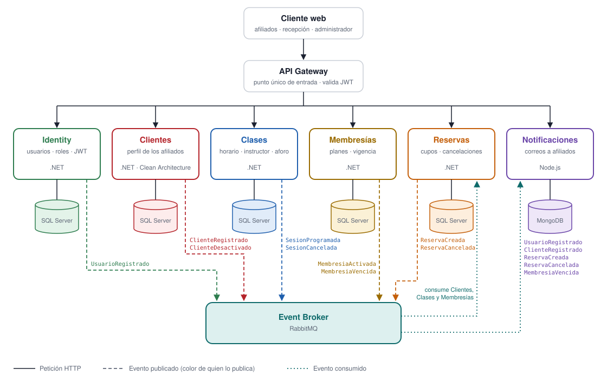
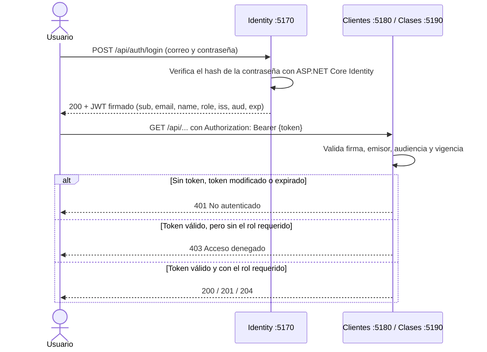
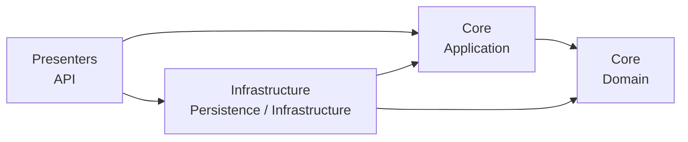

# FitCupo

Plataforma de reservas de clases grupales para un gimnasio, construida con microservicios.
Proyecto final de **Programación Distribuida**.

| Integrante | Entrega 1 | Entrega 2 |
|---|---|---|
| Samuel Metaute Restrepo | Estructura de la solución y capa de Dominio | Identity: ASP.NET Core Identity, usuarios, roles y seeders |
| Juana Ospina | Capa de Aplicación: mediador, paginación y contratos | Identity: inicio de sesión y emisión del JWT |
| David Viloria | Casos de uso (commands y queries) | Clases: dominio y casos de uso |
| Victor Manuel David | Capa de Persistencia (EF Core y SQL Server) | Clases: persistencia y API protegida con JWT |
| Carlos Arango | Capa de Presentación (API) y documentación | Clientes protegido por roles y documentación |

## Arquitectura general

El sistema se divide en microservicios independientes, cada uno con su propia base de datos.
El cliente web entra siempre por el API Gateway y los microservicios se comunican por eventos con RabbitMQ.



| Microservicio | Estado | Responsabilidad | Puerto | Publica | Consume |
|---|---|---|---|---|---|
| **Clientes** | ✅ Entrega 1 | Perfil de los afiliados del gimnasio | 5180 | `ClienteRegistrado`, `ClienteDesactivado` | — |
| **Identity** | ✅ Entrega 2 | Usuarios, roles y tokens JWT | 5170 | `UsuarioRegistrado` | — |
| **Clases** | ✅ Entrega 2 | Catálogo de clases y horario de sesiones con instructor y aforo | 5190 | `SesionProgramada`, `SesionCancelada` | — |
| Membresías | Pendiente | Planes y vigencia de las membresías | — | `MembresiaActivada`, `MembresiaVencida` | — |
| Reservas | Pendiente | Reserva de cupos en las clases | — | `ReservaCreada`, `ReservaCancelada` | Eventos de Clientes, Clases y Membresías |
| Notificaciones | Pendiente | Correos a los afiliados (Node.js) | — | — | `UsuarioRegistrado`, `ClienteRegistrado`, `ReservaCreada`, `ReservaCancelada`, `MembresiaVencida` |

Los eventos muestran el diseño acordado; todavía no se publican en RabbitMQ.
En esta entrega no hay API Gateway: **cada microservicio valida el JWT por su cuenta**, como pide el enunciado.

Clientes e Identity están separados: Identity guarda las credenciales y los roles para iniciar sesión;
Clientes guarda el perfil del afiliado (documento, contacto, contacto de emergencia y estado).
Los dos se relacionan por el correo: el afiliado ve su perfil en `GET /api/clients/me` con el correo de su token.

## Seguridad con JWT (Entrega 2)



- **Identity** está hecho con **ASP.NET Core Identity** y **Entity Framework Core**. Las contraseñas se guardan como hash (PBKDF2 con sal), nunca en texto plano. Después de 5 intentos fallidos la cuenta se bloquea 5 minutos.
- **Seeders:** al iniciar, `RoleSeeder` crea los roles y `UserSeeder` crea los usuarios con su rol. Si ya existen, no los duplica. No hay CRUD de usuarios ni de roles.
- **JWT firmado con HMAC-SHA256.** Dura 60 minutos (`Jwt:ExpirationMinutes`) y lleva los claims para identificar al usuario y sus roles.
- **Validación en cada microservicio** (`Security/JwtAuthenticationExtensions.cs`): firma, emisor (`FitCupo.Identity`), audiencia (`FitCupo`), algoritmo y vigencia, sin tolerancia de reloj. No basta con decodificar el token.
- **Autorización con los mecanismos de ASP.NET Core:** `[Authorize]` y `[Authorize(Roles = ...)]`. En Clases, además, un instructor solo puede cancelar **sus** sesiones: se compara el usuario del token con el instructor de la sesión.

### Usuarios y roles iniciales

Todos tienen la contraseña **`FitCupo2026*`** (se lee de `Seed:DefaultPassword` en `appsettings.Development.json`).

| Usuario | Nombre | Rol | Qué puede hacer |
|---|---|---|---|
| `admin@fitcupo.com` | Andrea Ruiz | `Admin` | Todo: clientes, catálogo de clases, cancelar cualquier sesión y ver los usuarios |
| `recepcion@fitcupo.com` | Mateo Torres | `Receptionist` | Registrar, consultar y actualizar clientes |
| `instructor@fitcupo.com` | Carolina Ríos | `Instructor` | Programar sesiones y cancelar las suyas |
| `instructor2@fitcupo.com` | Julián Pérez | `Instructor` | Igual que el anterior; sirve para probar que no puede cancelar sesiones ajenas |
| `afiliado@fitcupo.com` | Laura Gómez | `Member` | Consultar el catálogo, el horario y su propio perfil |

### Contenido del JWT

| Claim | Ejemplo | Uso |
|---|---|---|
| `sub` | `01a1da45-2df8-...` | Id del usuario en Identity |
| `email` | `admin@fitcupo.com` | Perfil del afiliado en Clientes |
| `name` | `Andrea Ruiz` | Nombre del instructor en las sesiones |
| `role` | `Admin` | Autorización por roles |
| `iss` / `aud` | `FitCupo.Identity` / `FitCupo` | Se validan en cada microservicio |
| `iat` / `nbf` / `exp` | fechas Unix | Vigencia de 60 minutos |
| `jti` | GUID | Identificador único del token |

### Permisos por endpoint

| Microservicio | Endpoint | Admin | Receptionist | Instructor | Member |
|---|---|:-:|:-:|:-:|:-:|
| Identity | `POST /api/auth/login` | público | público | público | público |
| Identity | `GET /api/auth/me` | ✅ | ✅ | ✅ | ✅ |
| Identity | `GET /api/users` | ✅ | ❌ | ❌ | ❌ |
| Clientes | `GET`, `POST /api/clients` · `GET`, `PUT /api/clients/{id}` | ✅ | ✅ | ❌ | ❌ |
| Clientes | `PATCH /api/clients/{id}/deactivate` · `/activate` | ✅ | ❌ | ❌ | ❌ |
| Clientes | `GET /api/clients/me` | ❌ | ❌ | ❌ | ✅ |
| Clases | `GET /api/classes` · `GET /api/classes/{id}` | ✅ | ✅ | ✅ | ✅ |
| Clases | `POST`, `PUT /api/classes` · `PATCH .../deactivate` · `.../activate` | ✅ | ❌ | ❌ | ❌ |
| Clases | `GET /api/sessions` · `GET /api/sessions/{id}` | ✅ | ✅ | ✅ | ✅ |
| Clases | `POST /api/sessions` | ❌ | ❌ | ✅ | ❌ |
| Clases | `PATCH /api/sessions/{id}/cancel` | ✅ cualquiera | ❌ | ✅ solo las suyas | ❌ |

### 401 frente a 403

Los dos errores responden con **ProblemDetails** y un mensaje que explica el motivo:

| Caso | Código | `detail` |
|---|---|---|
| Petición sin token | 401 | Debes enviar un token JWT en el encabezado Authorization: Bearer {token}. |
| Token expirado | 401 | El token expiró el 2025-12-31 23:00:00 UTC. Inicia sesión de nuevo. |
| Token modificado o firmado con otra clave | 401 | La firma del token no es válida: el token fue modificado o no lo emitió Identity. |
| Token de otro emisor | 401 | El token no fue emitido por FitCupo Identity. |
| Usuario autenticado sin el rol | 403 | Laura Gómez inició sesión, pero su rol (Member) no tiene permiso para este recurso. |
| Instructor que cancela una sesión ajena | 403 | Solo puedes cancelar las sesiones que tú dictas. |

## Microservicios

Los tres siguen **Clean Architecture**: las dependencias apuntan hacia el centro, el controller solo usa `IMediator`
y los casos de uso están separados en *commands* y *queries* (CQRS).



### Identity

| Capa | Proyecto | Contenido |
|---|---|---|
| Aplicación | `FitCupo.Identity.Application` | Casos de uso `Login`, `GetUserById` y `GetUserList`; contratos `IIdentityService` e `ITokenGenerator`; roles |
| Infraestructura | `FitCupo.Identity.Infrastructure` | `ApplicationUser`, `ApplicationRole` y `ApplicationUserRole`; `FitCupoIdentityDbContext`; seeders; `IdentityService` con `UserManager` y `SignInManager`; `JwtTokenGenerator` |
| Presentación | `FitCupo.Identity.API` | `AuthController`, `UsersController`, validación de JWT y manejo de errores |

Identity no tiene capa de Dominio: las reglas de usuarios y contraseñas las aplica ASP.NET Core Identity.
Las tablas son `Users`, `Roles` y `UserRoles` (relación muchos a muchos, llave `(UserId, RoleId)`), más las auxiliares de Identity.

### Clases

| Capa | Proyecto | Contenido |
|---|---|---|
| Dominio | `FitCupo.Classes.Domain` | Agregados `GymClass` y `ClassSession`, value object `TimeSlot` y reglas de negocio |
| Aplicación | `FitCupo.Classes.Application` | Commands y queries del catálogo y del horario, mediador, paginación y contratos |
| Persistencia | `FitCupo.Classes.Persistence` | `ClassesDbContext`, configuraciones, repositorios, Unit of Work, migración y 3 clases iniciales |
| Presentación | `FitCupo.Classes.API` | `GymClassesController`, `ClassSessionsController`, validación de JWT y manejo de errores |

Reglas de negocio:

- El nombre de la clase es único. La duración va de 15 a 180 minutos y el aforo, de 1 a 60 personas.
- Solo se programan sesiones de clases activas, en una fecha futura y con máximo 60 días de anticipación.
- La hora de fin se calcula con la duración de la clase. El cupo de la sesión no puede superar el aforo de la clase.
- Un salón no puede tener dos sesiones que se crucen, y un instructor tampoco (409).
- El instructor de la sesión es el usuario del token: su Id (`sub`) y su nombre (`name`).
- Solo se cancela una sesión que no ha empezado, con un motivo de 5 a 200 caracteres.

### Clientes

| Capa | Proyecto | Contenido |
|---|---|---|
| Dominio | `FitCupo.Clients.Domain` | Agregado `Client`, value objects (`Document`, `Email`, `PhoneNumber`, `EmergencyContact`) y reglas de negocio |
| Aplicación | `FitCupo.Clients.Application` | Casos de uso con CQRS, mediador propio, DTOs, paginación y contratos de repositorio y Unit of Work |
| Persistencia | `FitCupo.Clients.Persistence` | `ClientsDbContext`, configuración de EF Core, repositorios, Unit of Work y migraciones |
| Presentación | `FitCupo.Clients.API` | Controller REST, validación de JWT, manejo global de errores y documentación OpenAPI |

Reglas de negocio:

- El documento es único y no se puede cambiar. La cédula solo admite números; el pasaporte, letras y números.
- El correo es único y se guarda en minúsculas.
- El cliente debe tener entre 14 y 100 años.
- El teléfono del contacto de emergencia debe ser distinto al del cliente.
- Un cliente inactivo no puede modificar sus datos. No se puede desactivar un cliente inactivo ni activar uno activo.
- Los clientes no se eliminan: se desactivan para conservar su historial.

## Cómo ejecutarlo

### Requisitos

- [.NET SDK 10](https://dotnet.microsoft.com/download/dotnet/10.0)
- SQL Server. Sirve **LocalDB**, que se instala con Visual Studio, o SQL Server en Docker.

### Iniciar los tres microservicios

```bash
git clone https://github.com/samrx21/fitcupo.git
cd fitcupo
scripts\run-all.cmd
```

El script abre una ventana por microservicio. También se pueden iniciar a mano, cada uno en su terminal:

```bash
dotnet run --project services/identity/src/Presenters/FitCupo.Identity.API
dotnet run --project services/clients/src/Presenters/FitCupo.Clients.API
dotnet run --project services/classes/src/Presenters/FitCupo.Classes.API
```

En Visual Studio, abre `FitCupo.sln`, clic derecho en la solución → **Configurar proyectos de inicio** → **Varios proyectos de inicio**
y marca las tres API.

Al iniciar en modo Development, cada API **crea su base de datos y aplica las migraciones**.
Identity, además, **ejecuta los seeders** y muestra en la consola los roles y usuarios que crea.

| Microservicio | Documentación interactiva | Base de datos |
|---|---|---|
| Identity | http://localhost:5170/scalar | `FitCupoIdentity` |
| Clientes | http://localhost:5180/scalar | `FitCupoClients` |
| Clases | http://localhost:5190/scalar | `FitCupoClasses` |

En Scalar, inicia sesión en Identity, copia el `accessToken` y pégalo en **Authentication → Bearer** de Clientes o Clases.

### Configuración del JWT

Los tres `appsettings.json` comparten la sección `Jwt` (emisor, audiencia y clave de firma). Identity agrega `ExpirationMinutes`.
La clave del repositorio es solo para desarrollo; en producción se reemplaza con una variable de entorno,
sin modificar el archivo:

```powershell
$env:Jwt__SigningKey = "una-clave-secreta-de-al-menos-32-caracteres"
```

### Usar SQL Server en Docker en lugar de LocalDB

```powershell
docker run -e "ACCEPT_EULA=Y" -e "MSSQL_SA_PASSWORD=FitCupo#2026" -p 1433:1433 -d mcr.microsoft.com/mssql/server:2022-latest
$env:ConnectionStrings__DefaultConnection = "Server=localhost,1433;Database=FitCupoClients;User Id=sa;Password=FitCupo#2026;TrustServerCertificate=True"
dotnet run --project services/clients/src/Presenters/FitCupo.Clients.API
```

Cambia el nombre de la base de datos (`FitCupoIdentity`, `FitCupoClients` o `FitCupoClasses`) según el microservicio.

### Migraciones

Desde la carpeta de cada microservicio (`services/identity`, `services/clients` o `services/classes`):

```bash
dotnet tool restore
scripts\ef.cmd add NombreDeLaMigracion
scripts\ef.cmd update
```

## Probar los escenarios de seguridad

- **Colección de Postman:** [`docs/postman/FitCupo-Seguridad.postman_collection.json`](docs/postman/FitCupo-Seguridad.postman_collection.json).
  Tiene una carpeta por escenario de la rúbrica. Cada petición guarda los tokens que necesitan las siguientes y verifica el código esperado,
  así que se puede ejecutar completa con **Run collection**. Genera el token expirado y el token modificado dentro de Postman.
- **Colección de Clientes:** [`docs/postman/FitCupo-Clients.postman_collection.json`](docs/postman/FitCupo-Clients.postman_collection.json), ahora inicia sesión primero.
- **Archivos `.http`** para Visual Studio o VS Code: uno por microservicio, en la carpeta de cada API.
- **Evidencias:** [`docs/evidencias-seguridad.md`](docs/evidencias-seguridad.md) con las respuestas reales de cada escenario.

| Escenario de la rúbrica | Carpeta de Postman |
|---|---|
| 1. Ejecución de los microservicios | 1. Microservicios en ejecución |
| 2. Inicialización de Identity | 2. Usuarios y roles creados por los seeders |
| 3. Autenticación y emisión del JWT | 3. Autenticación y emisión del JWT |
| 4. Acceso sin token (401) | 4. Acceso sin token (401) |
| 5. Acceso con token válido | 5. Acceso con token válido (200) |
| 6. Autorización por roles | 6. Autorización por roles: usuario con el rol requerido |
| 7. Acceso sin el rol requerido (403) | 7. Usuario autenticado sin el rol requerido (403) |
| 8. Token inválido o expirado (401) | 8. Token inválido o expirado (401) |

## Flujo de trabajo con Git Flow

| Rama | Uso |
|---|---|
| `main` | Versiones entregadas. Solo recibe merges desde `release/*` |
| `develop` | Integración del trabajo del equipo |
| `feature/*` | Una rama por tarea, creada desde `develop` |
| `release/*` | Preparación de cada entrega antes de pasar a `main` |

Cada integrante trabajó en su rama `feature/*` y la integró a `develop` mediante un **pull request revisado por otro integrante**.
Cada entrega se publica con una rama `release/x.y.z` que se fusiona en `main` y se etiqueta: `v1.0.0` (Entrega 1) y `v2.0.0` (Entrega 2).

## Estructura del repositorio

```
fitcupo/
├── FitCupo.sln                      Solución con los tres microservicios
├── scripts/run-all.cmd              Inicia los tres microservicios
├── docs/
│   ├── arquitectura/                Diagrama de microservicios
│   ├── postman/                     Colecciones de seguridad y de Clientes
│   └── evidencias-seguridad.md      Resultados de los escenarios
└── services/
    ├── identity/                    Microservicio Identity (puerto 5170)
    │   ├── FitCupo.Identity.sln
    │   └── src/
    │       ├── Core/FitCupo.Identity.Application/
    │       ├── Infrastructure/FitCupo.Identity.Infrastructure/
    │       └── Presenters/FitCupo.Identity.API/
    ├── clients/                     Microservicio de Clientes (puerto 5180)
    │   ├── FitCupo.Clients.sln
    │   └── src/
    │       ├── Core/FitCupo.Clients.Domain/ y FitCupo.Clients.Application/
    │       ├── Infrastructure/FitCupo.Clients.Persistence/
    │       └── Presenters/FitCupo.Clients.API/
    └── classes/                     Microservicio de Clases (puerto 5190)
        ├── FitCupo.Classes.sln
        └── src/
            ├── Core/FitCupo.Classes.Domain/ y FitCupo.Classes.Application/
            ├── Infrastructure/FitCupo.Classes.Persistence/
            └── Presenters/FitCupo.Classes.API/
```
